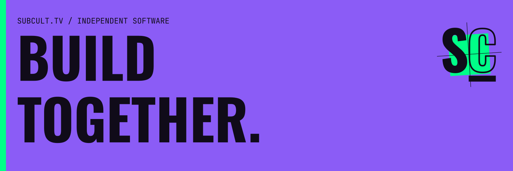

# SUBCULT

We make software for independent culture: a clip channel, a recording archive,
a neighborhood board, the door at a show. Each product has a job. This is the
workshop behind them.

[Explore the products](https://subcult.tv/products) · [Read the workshop notes](https://subcult.tv/) · [Support the work](https://subcult.tv/support)

## What we're building

| Product | The job | Where it stands |
| --- | --- | --- |
| [clpr](https://clpr.tv/) | Find Twitch clips by creator, topic and tag; keep playlists. | Public web app |
| [HasanAra](https://hasanara.tv/) | Search the broadcast record and return to the timestamp. | Public independent archive |
| [Rekolekt](https://subcult.tv/products/rekolekt) | Run a searchable, timestamped recording archive under your own name. | Software you deploy |
| [Undertow](https://undertow.subcult.tv/) | Put visuals and timed lyrics around a track; export video locally. | Public browser editor |
| [Kork](https://kork.subcult.tv/) | Make a free link page with your socials, media and payment buttons. | Early public service |
| [Patchwork](https://patchwork.subcult.tv/) | Try a neighborhood board for requests, offers and resources. | Pre-alpha demo; no real help requests |
| [Subcult OS](https://subcult.tv/products/subcult-os) | Prepare the crew, reserve free tickets, run the door and close out. | Alpha development |
| [Prichal](https://subcult.tv/products/prichal) | Account hosting for the open social web. | Private preview; no sign-up |
| [Left Field](https://left-field.subcult.tv/) | Read seat-level public records, provisional scores and source gaps. | Research site in active development |

Dedhed is our private concert-tape pilot. Tadooer is a private planner for one
owner. Neither has a public sign-up or listening address.

## Inside the workshop

This private repository holds the public website, its authenticated admin
workspace and Studio: brand systems, editable artwork, reviewed media and
preparation tools. Product code lives in the linked product repositories.

We keep the originals in Studio and select the graphics that leave it by name
and source hash. A draft is still a draft. Preparing artwork or copy does not
publish a post or deploy a site.

For setup, tests, the repository map and source boundaries, read the
[repository development guide](DEVELOPMENT.md). The
[contribution guide](CONTRIBUTING.md) covers changes; the
[asset policy](docs/ASSETS.md) covers source ownership and exports.

Application code uses the [MIT license](LICENSE). Fonts, references and media
retain their own licenses and source records.
